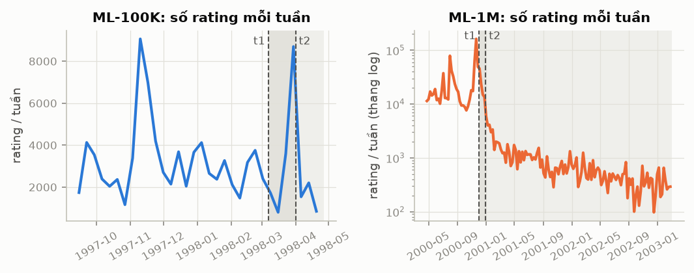
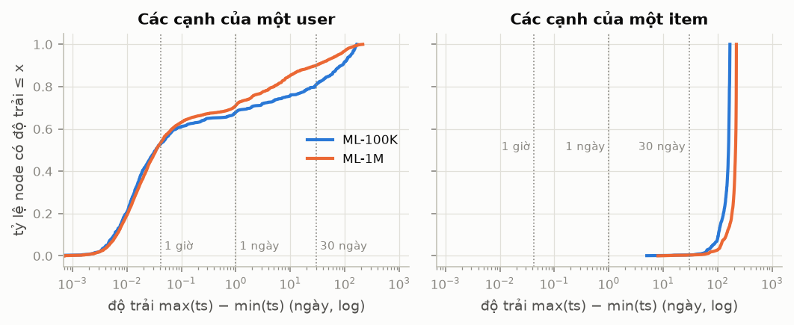
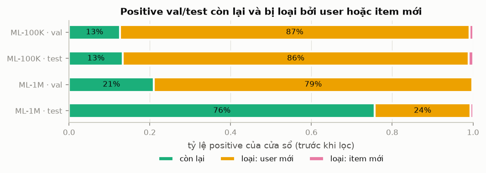
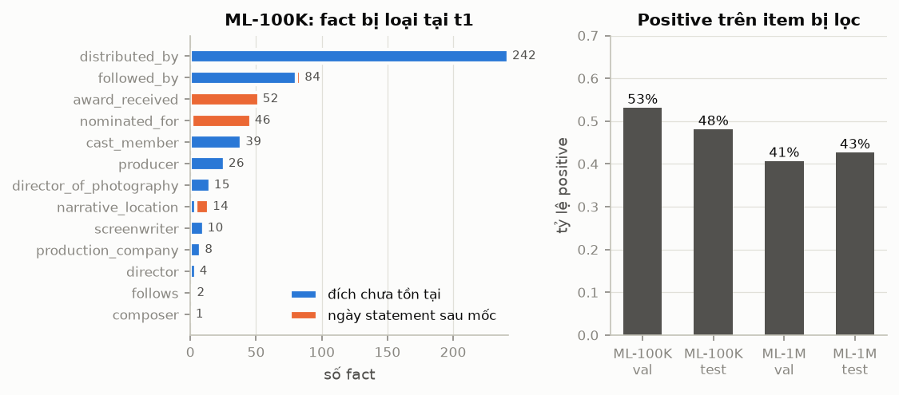

# Báo cáo dữ liệu: MovieLens, liên kết Wikidata và KG theo thời gian

Dự án T-KGAT — Temporal Knowledge Graph Attention Network for Recommendation. Báo cáo dành cho cô Nguyễn Ngọc Minh Châu; nhóm thực hiện: Đởm Quang Minh Triết, Nguyễn Đăng Phôn.

Mọi ngày và mọi mốc thời gian trong báo cáo tính theo UTC. Mọi con số được sinh bởi `scripts/07_report_numbers.py` từ các file do pipeline ghi ra (bảng đầy đủ kèm nguồn: `docs/data-report-numbers.md`); chỗ nguồn chưa tồn tại được ghi đúng là "chưa có". Số item luôn kèm cơ sở đếm, vì báo cáo dùng ba cách đếm khác nhau (Bảng 2).

## Tóm tắt

- **Dữ liệu.** ML-100K có 943 user, 1.682 item được rating, 100.000 rating, từ 20/09/1997 đến 22/04/1998. ML-1M có 6.040 user, 3.706 item được rating, 1.000.209 rating, từ 25/04/2000 đến 28/02/2003, nhưng 90,5% rating nằm trong năm 2000. Cả 9 file gốc khớp SHA-256.
- **Timestamp là lúc nhập rating.** 77,9% rating của ML-100K và 72,4% của ML-1M nằm trong 24 giờ đầu của user. Vì vậy các cạnh của một user gần như trùng thời điểm, còn các cạnh của một item trải trên nhiều tháng (mục 3).
- **Chia theo mốc t1/t2** giữ lại 12,6% (val) và 13,3% (test) positive của ML-100K, tức chỉ 66 và 51 user; ML-1M giữ lại 21,0% và 75,7% với 480 và 952 user (mục 4).
- **KG theo thời gian** chỉ bỏ 1,5% (ML-100K) và 1,3% (ML-1M) số fact tại t1, nhưng các item mất fact nhận 53,1% và 48,1% positive val/test của ML-100K, 40,6% và 42,6% của ML-1M (mục 6).
- **Baseline trên ML-1M** (Recall@20 trên test): MostPop 0,0902; MostPop recent (cửa sổ 7 ngày) 0,1060; BPR-MF 0,1194 ± 0,0031. Baseline ML-100K: chưa có (mục 7).

## 1. Hai bộ dữ liệu

Nhóm dùng MovieLens-100K (bộ chính theo kế hoạch, do Phôn chạy) và MovieLens-1M (cỡ lớn hơn, do Triết chạy song song, cùng quy trình và cùng mã). Liên kết thực thể dùng KB4Rec (MovieLens-20M → Freebase/YAGO) và các fact có ngày lấy từ Wikidata. Cả 9 file gốc được kiểm bằng SHA-256 (`scripts/01_verify_data.py`): 9 khớp, 0 thiếu, 0 lệch. Bản chụp Wikidata ngày 17/10/2026 gồm 119.748 fact, 18 quan hệ, 3.725 phim.

| | ML-100K | ML-1M |
|---|---|---|
| User (có ít nhất một rating) | 943 | 6.040 |
| Item được rating | 1.682 | 3.706 |
| Rating | 100.000 | 1.000.209 |
| Mật độ = rating / (user × item được rating) | 6,3% | 4,5% |
| Khoảng thời gian (UTC) | 20/09/1997 – 22/04/1998 | 25/04/2000 – 28/02/2003 |
| Số ngày giữa rating đầu và cuối (làm tròn) | 215 | 1.039 |
| Trung vị số rating mỗi user | 65 | 96 |
| Rating ≥ 4 (positive), trên mọi rating gốc | 55,4% | 57,5% |
| Năm có nhiều rating nhất | 1997 (52,9%) | 2000 (90,5%) |

*Bảng 1. Quy mô và khoảng thời gian của hai bộ dữ liệu gốc (trước làm sạch).*

Hai bộ dữ liệu khác nhau về thời gian: ML-100K gói trong 215 ngày, còn ML-1M kéo dài tới năm 2003 nhưng gần như toàn bộ rating nằm trong năm 2000. Điều này giải thích vì sao các cửa sổ val và test của ML-1M có độ dài rất khác nhau (mục 4).

| Cơ sở đếm item | ML-100K | ML-1M |
|---|---|---|
| Item được rating (dữ liệu gốc) | 1.682 | 3.706 |
| Item trong danh mục liên kết, sau làm sạch (kể cả item chưa có rating) | 1.663 | 3.883 |
| Item trong train, sau 5-core | 932 | 3.009 |

*Bảng 2. Ba cơ sở đếm item.*

## 2. Làm sạch

Chỉ ML-100K được làm sạch (cấu hình `clean: true`); ML-1M không có item thiếu tiêu đề hay trùng tiêu đề nên không làm sạch.

- **Item không có tiêu đề:** bỏ item 267 cùng 9 rating của nó, vì không có tiêu đề thì không thể liên kết với KB4Rec.
- **Item trùng tiêu đề:** 18 item mang cùng tiêu đề với một item khác (thường là cùng một phim có nhiều id); gộp lại và gán lại 608 rating.
- **Cặp (user, item) trùng:** giữ lần rating sớm nhất (quyết định 0002); ML-100K loại 307 cặp, ML-1M không có cặp nào.

Kết quả: ML-100K từ 1.682 item được rating còn 1.663 item trong danh mục sau làm sạch (bỏ 1 item không tiêu đề và gộp 18 item trùng tiêu đề); số rating là 99.991 sau làm sạch và 99.684 sau khử trùng. ML-1M giữ nguyên 1.000.209 rating. Mục 1 dùng dữ liệu gốc nên chưa trừ các phần này.

## 3. Rating theo phiên và hệ quả cho Δt

**Timestamp là lúc nhập rating, không phải lúc xem phim.** Người dùng đăng ký rồi chấm hàng loạt phim đã xem từ trước. Hình 1 cho thấy số rating mỗi tuần dao động mạnh với những tuần tăng đột biến; ở ML-1M, trục log cho thấy lượng rating giảm dần sau các tuần đó. Báo cáo chưa kiểm tra nguyên nhân của các đột biến.

- **24 giờ đầu của user:** 77,9% rating của ML-100K và 72,4% của ML-1M nằm trong 24 giờ kể từ rating đầu tiên của user. Nếu đếm theo ngày lịch UTC, tỷ lệ là 73,5% và 66,0%. 63,5% user của ML-100K và 58,7% của ML-1M chỉ hoạt động đúng một ngày.
- **Phiên** (kết thúc khi nghỉ quá 60 phút): 2.692 phiên ở ML-100K và 24.413 phiên ở ML-1M; trung vị mỗi user chỉ có 1 phiên; trung vị thời lượng của phiên có từ 2 rating là 13,4 và 13,1 phút. Với ngưỡng nghỉ 30 phút, số phiên là 2.793 và 25.163, nên cách tách phiên ít ảnh hưởng đến mô tả này.
- **Khoảng cách giữa hai rating liên tiếp của một user** ngắn hơn 1 phút ở 76,8% (ML-100K) và 82,9% (ML-1M) trường hợp.

**Δt giữa các cạnh của cùng một node.** T-KGAT trừ một số hạng phụ thuộc Δt vào điểm attention trước softmax, và softmax chỉ so sánh các cạnh của cùng một node; vì vậy điều đáng đo là độ trải thời gian của các cạnh train (trước t1) trong một node, không phải Δt trung bình toàn bộ dữ liệu (Hình 2).

| Độ trải của các cạnh train trong một node | ML-100K | ML-1M |
|---|---|---|
| **User:** nhỏ hơn 1 giờ | 53,0% | 53,4% |
| User: nhỏ hơn 1 ngày | 68,1% | 71,1% |
| User: nhỏ hơn 30 ngày | 80,9% | 90,1% |
| User: trung vị độ lệch chuẩn của (t1 − ts) | khoảng 14 phút | khoảng 14 phút |
| **Item:** nhỏ hơn 1 giờ | 0,0% | 0,0% |
| Item: nhỏ hơn 1 ngày | 0,0% | 0,0% |
| Item: nhỏ hơn 30 ngày | 0,3% | 0,4% |
| Item: trung vị độ lệch chuẩn của (t1 − ts) | 45 ngày | 67 ngày |

*Bảng 3. Độ trải thời gian của các cạnh train theo user và theo item.*

Quan sát: trong cùng một user, các Δt gần như bằng nhau, nên phép trừ phụ thuộc Δt khó làm đổi thứ tự attention ở phía user; ở phía item, các cạnh trải trên nhiều tháng nên Δt có thể có tác dụng. Đây mới là **giả thuyết** cho RQ3, chưa phải kết luận. Nhóm sẽ kiểm bằng thí nghiệm hoán vị timestamp (bắt buộc cho mọi biến thể có thời gian); số liệu hiện có chưa đủ để nói Δt giúp hay không giúp mô hình.

## 4. Chia theo mốc t1/t2 và bằng chứng không rò rỉ

**Quy trình** (quyết định 0002): khử trùng cặp (user, item); hai mốc toàn cục t1 và t2 là phân vị 80% và 90% thời gian của mọi timestamp, với train trước t1, val từ t1 đến trước t2, test từ t2; positive là rating ≥ 4; 5-core tính trên train positive; val và test chỉ giữ user và item đã có trong train; mask khi xếp hạng chỉ chứa tương tác trước mốc; chọn mô hình trên val, test chỉ chấm một lần cho cấu hình đã chọn. Mốc của ML-100K là t1 = 07/03/1998 và t2 = 31/03/1998; của ML-1M là t1 = 02/12/2000 và t2 = 29/12/2000.

Train sau 5-core có 43.018 positive (từ 43.929 trước 5-core), 745 user và 932 item ở ML-100K; 461.858 positive (từ 463.017), 5.350 user và 3.009 item ở ML-1M (item trong train sau 5-core).

| Cửa sổ | Positive trước lọc | Loại vì user mới | Loại vì item mới | Còn lại | Tỷ lệ còn lại | User còn lại |
|---|---|---|---|---|---|---|
| ML-100K val | 5.648 | 4.886 | 50 | 712 | 12,6% | 66 |
| ML-100K test | 5.612 | 4.805 | 60 | 747 | 13,3% | 51 |
| ML-1M val | 57.812 | 45.605 | 74 | 12.133 | 21,0% | 480 |
| ML-1M test | 54.452 | 12.911 | 343 | 41.198 | 75,7% | 952 |

*Bảng 4. Positive của val và test trước và sau khi loại user hoặc item không có trong train.*

Chú thích: "user mới" ở bảng này là user không có trong train sau 5-core (không nhất thiết là user mới đăng ký; xem phân tích bên dưới), và "item mới" là item không có trong train sau 5-core. Positive bị loại vì user mới được đếm trước; chỉ phần còn lại mới xét item.

- **ML-100K:** phần lớn positive của val và test bị loại vì user mới (4.886 trên 5.648 positive ở val, 4.805 trên 5.612 ở test). Trong các positive bị loại đó, 99,8% (val) và 99,6% (test) thuộc user có rating đầu tiên từ t1 trở đi, tức user chưa có tương tác nào trước mốc (116 trong 117 user bị loại ở val, 96 trong 97 ở test). Điều này phù hợp với việc rating được nhập theo phiên ngay sau khi đăng ký (mục 3). Chỉ còn 12,6% và 13,3% positive, tức 66 và 51 user. Kết quả trên bộ này sẽ nhiễu: báo cáo mọi số kèm độ lệch chuẩn qua seed và cần kiểm định cặp.
- **ML-1M:** val dài 27 ngày (từ 02/12/2000 đến 29/12/2000): 45.605 trên 57.812 positive bị loại vì user mới, và 99,0% trong số đó thuộc user có rating đầu tiên từ t1 trở đi (611 trong 622 user bị loại); chỉ còn 21,0% positive (480 user). Test dài 791 ngày: 12.911 trên 54.452 positive bị loại vì user mới, trong đó 83,7% thuộc user có rating đầu tiên từ t1 trở đi (195 trong 233 user bị loại) và 16,3% thuộc user đã có rating trước t1 nhưng không vào train; báo cáo chưa phân tách lý do (không có positive trước t1, hay bị loại bởi 5-core). 75,7% positive của test (952 user) thuộc user có trong train. Mỗi cửa sổ chứa khoảng 10% số rating (phân vị 80% và 90%), nhưng độ dài và thành phần user khác hẳn nhau, nên điểm val và điểm test của ML-1M không so trực tiếp được. Độ dài cửa sổ làm tròn đến ngày: ML-100K có val 25 ngày và test 22 ngày.
- **Vì sao nên dựa chủ yếu vào ML-1M khi kết luận:** test của ML-1M có 952 user, test của ML-100K chỉ có 51 user.

**Bằng chứng không rò rỉ.** `check_split` chạy trên split đã lưu của cả hai bộ trả về 0 vấn đề; nó kiểm thứ tự thời gian của train/val/test, việc val/test không chứa user hoặc item lạ, và mask chỉ chứa tương tác trước mốc. Các kiểm tra này cũng chạy trong CI cùng các test cố ý tạo ra từng loại rò rỉ để chắc rằng kiểm tra bắt được chúng.

## 5. Liên kết MovieLens → Freebase/Wikidata

KB4Rec liên kết MovieLens-20M với Freebase và YAGO. ML-1M dùng chung không gian id với MovieLens-20M; ML-100K dùng id riêng nên được ánh xạ sang ML-1M theo tiêu đề và năm (quyết định 0003), rồi theo id đó sang Freebase. Phim được tìm trên Wikidata qua mã Freebase.

| | ML-100K | ML-1M |
|---|---|---|
| Item trong danh mục (sau làm sạch) | 1.663 | 3.883 |
| Có liên kết Freebase | 1.617 (97,2%) | 3.811 (98,2%) |
| Tỷ lệ rating thuộc item có liên kết Freebase | 99,5% | 99,7% |
| Tỷ lệ item có liên kết YAGO | 83,1% | 84,1% |

*Bảng 5. Độ phủ liên kết (cơ sở: item trong danh mục sau làm sạch).*

Quy tắc ánh xạ ML-100K → ML-1M, theo thứ tự ưu tiên: khớp tiêu đề và năm cho 1.628 item, tiêu đề phụ (a.k.a.) và năm cho 13, chứa tiêu đề và năm cho 4, tiêu đề và năm lệch một năm cho 2; 16 item không khớp được.

**Tỷ lệ lỗi liên kết:** kiểm tay một mẫu ngẫu nhiên là việc 15 của Phôn. Số item đã kiểm: chưa có. Số liên kết sai: chưa có. Tỷ lệ lỗi: chưa có. Đã biết một lỗi của KB4Rec: phim *Clubland* bị liên kết nhầm sang Cloudland Canyon State Park; vì vậy độ phủ ở Bảng 5 là độ phủ chứ chưa phải độ chính xác.

## 6. KG theo thời gian

**Quy tắc** (quyết định 0004 và 0006). KG dùng tại mốc t chỉ giữ một fact nếu nó đã đúng trước t (so sánh chặt, ngày trùng mốc thì loại). Fact có ngày của statement (giải thưởng, đề cử…) giữ nếu ngày đó trước t. Fact trỏ tới thực thể chưa tồn tại tại t (phần tiếp theo, hãng phát hành ra đời sau) bị loại. Fact không có ngày nào, như phim → thể loại, được giữ theo mặc định. Ngày chỉ có năm được đọc là 31/12, ngày chỉ có tháng là ngày cuối tháng. Ngày phát hành của chính phim không dùng để loại fact của phim đó, vì mọi item của KG đã được rating trước t1. KG của train và val dựng tại t1, KG của test dựng tại t2. Ba biến thể: **default** (giữ fact không có ngày nào), **drop_undated** (bỏ chúng) và **static** (giữ mọi fact như bài báo KGAT; chỉ dùng làm tham chiếu để đo rò rỉ qua KG, không phải kết quả đúng theo thời gian).

**Các fact có ngày đến đâu.** Cơ sở: fact của item trong train, 37.103 fact cho 932 item ở ML-100K và 104.782 fact cho 3.009 item ở ML-1M (927 và 2.975 item trong số đó có ít nhất một fact).

- Chỉ 7,6% (ML-100K) và 5,8% (ML-1M) số fact có ngày của chính statement; 97,1% và 97,8% trong số đó thuộc `award_received` hoặc `nominated_for`, tức đúng hai quan hệ có thể kéo thông tin tương lai vào KG vì giải thưởng được trao sau khi phim ra mắt. Phần lớn fact còn lại chỉ có ngày tồn tại của thực thể đích; 18,1% (cả hai bộ) không có ngày nào.
- Chỉ `point_in_time` có độ chính xác kèm theo: trong 6.295 giá trị, 44,4% chỉ biết năm. Các cột ngày khác mất độ chính xác khi tải về, và Wikidata ghi ngày chỉ có năm thành `YYYY-01-01`: 58,3% ngày phát hành phim, 45,1% ngày thành lập của thực thể đích và 4,8% ngày sinh kết thúc bằng `-01-01`. Quyết định 0006 đọc các ngày này là năm-only (31/12), nên một fact thật sự xảy ra ngày 1/1 sẽ bị đặt muộn hơn: thận trọng, không làm lọt fact tương lai, nhưng có thể bỏ nhầm.

| Biến thể | ML-100K tại t1 | ML-100K tại t2 | ML-1M tại t1 | ML-1M tại t2 |
|---|---|---|---|---|
| default | 36.560 | 36.580 | 103.443 | 103.443 |
| drop_undated | 29.840 | 29.860 | 84.522 | 84.522 |
| static (tham chiếu) | 37.103 | 37.103 | 104.782 | 104.782 |

*Bảng 6. Số triple của KG theo biến thể và mốc.*

- **Fact bị lọc tại t1** (static trừ default): 543 fact (1,5%) ở ML-100K và 1.339 fact (1,3%) ở ML-1M. Lý do tại t1: đích chưa tồn tại là 433 và 1.069 fact; ngày statement sau mốc là 110 và 270 fact. Biến thể drop_undated bỏ thêm 6.720 và 18.921 fact không có ngày nào.
- **Từ t1 đến t2:** KG default của ML-100K tăng 20 triple, trong đó 19 là fact `award_received` được trao giữa hai mốc (số fact `award_received` "tương lai" giảm từ 52 xuống 33); ML-1M không đổi vì không có fact nào mang ngày rơi vào khoảng từ 02/12/2000 đến 29/12/2000. Số thực thể chỉ xuất hiện trong KG t2 là 1 ở ML-100K và 0 ở ML-1M; cách xử lý chưa quyết, sẽ chọn ở giai đoạn KGAT.

**Fact bị loại tập trung vào phim nổi tiếng.** 10% item phổ biến nhất trong train (93 item ở ML-100K, 301 item ở ML-1M) nắm 15,8% và 15,0% số fact, nhưng chiếm 44,3% và 35,8% số fact giải thưởng và đề cử "tương lai" bị loại tại t1 (97 fact trên 25 phim ở ML-100K; 260 fact trên 74 phim ở ML-1M). Với 20% item phổ biến nhất, các tỷ lệ này là 27,8% so với 64,9% (ML-100K) và 27,6% so với 44,6% (ML-1M).

**Phần tương tác bị ảnh hưởng.** Một item "bị lọc" là item có số triple khác nhau giữa static và default tại cùng một mốc. Có 344 item (36,9% item train) ở ML-100K và 899 item (29,9% item train) ở ML-1M. Các item này nhận 53,1% positive val và 48,1% positive test của ML-100K, 40,6% và 42,6% của ML-1M. Tức là dù chỉ một phần nhỏ fact bị lọc, phần lớn các tương tác dùng để chọn mô hình và chấm điểm nằm trên item mà KG tĩnh chứa thông tin tương lai. Mức ảnh hưởng thực tế lên Recall@20 **chưa được đo**: chỉ có thể đo khi chạy KGAT với hai biến thể.

**Hai ví dụ.** *Titanic (1997)* có 136 fact; KG tại t1 thiếu 28 fact trong số đó, gồm ba nhóm:

- 11 giải thưởng, đều là giải Oscar, được trao ngày 23/03/1998, sau t1 (07/03/1998) nhưng trước t2 (31/03/1998): chúng không có trong KG của train/val nhưng có trong KG của test.
- 15 giải hoặc đề cử bị loại ở cả hai mốc, trong đó 13 giải chỉ ghi năm.
- 2 fact khác, không phải giải thưởng: `distributed_by → Disney+` (ngày tồn tại của đích: 12/11/2019) và `cast_member → Lewis Abernathy` (ngày tồn tại của đích: 31/12/2000). Cả hai bị loại vì thực thể đích chưa tồn tại tại hai mốc. Ngày của Lewis Abernathy là ngày sinh mà Wikidata ghi là `2000-01-01`, và quy tắc năm-only đọc thành 31/12; với một người tham gia phim năm 1997 thì ngày này đáng ngờ, nhưng báo cáo chưa kiểm tra lại nguồn.

*Toy Story (1995)* mất 2 fact tại t1, trong đó có liên kết `followed_by → Toy Story 2`, phim ra mắt ngày 24/11/1999, sau toàn bộ dữ liệu ML-100K: một KG tĩnh sẽ cho mô hình biết trước phim này có phần tiếp theo.

## 7. Baseline

Baseline chính thức hiện chỉ có trên ML-1M. Mỗi baseline được chọn cấu hình trên val; chỉ điểm test của cấu hình đã chọn được ghi lại. MostPop không có yếu tố ngẫu nhiên nên chỉ chạy một lần (không có độ lệch chuẩn); BPR-MF chạy với 5 seed (2019–2023), báo cáo trung bình ± độ lệch chuẩn mẫu. Test có 952 user, val có 480 user.

| Mô hình (ML-1M) | Cấu hình chọn trên val | Recall@20 (test) | NDCG@20 (test) | Số seed |
|---|---|---|---|---|
| MostPop | toàn bộ train | 0,0902 | 0,1942 | 1 |
| MostPop recent | cửa sổ 7 ngày | 0,1060 | 0,2034 | 1 |
| BPR-MF | dim = 64, l2 = 0,0001, lr = 0,001 | 0,1194 ± 0,0031 | 0,2208 ± 0,0069 | 5 |
| Cả ba mô hình trên ML-100K | chưa có | chưa có | chưa có | chưa có |

*Bảng 7. Baseline trên ML-1M; ML-100K chưa chạy (việc 17).*

**Cửa sổ của MostPop recent.** Lưới ban đầu {7, 14, 30} ngày chọn 7 ngày, tức giá trị nhỏ nhất của lưới và val giảm đều khi cửa sổ dài ra, nên giá trị tốt nhất có thể còn nhỏ hơn. Quyết định 0007 mở rộng lưới thành {1, 3, 5, 7, 14, 30} ngày. Recall@20 trên val theo cửa sổ 1, 3, 5, 7, 14 và 30 ngày là 0,0748; 0,1130; 0,1289; 0,1336; 0,1082 và 0,0986. 7 ngày vẫn được chọn và nay nằm giữa lưới, nên biên của lưới không còn là vấn đề; điểm test không đổi.

**Cách đọc.** Về điểm trung bình, MostPop recent cao hơn MostPop và BPR-MF cao hơn cả hai ở Recall@20 và NDCG@20. Chưa có kiểm định thống kê giữa các baseline (Wilcoxon theo từng user, việc 19), và MostPop chỉ có một lần chạy nên chưa nói được về độ ổn định. Sau này mô hình có yếu tố thời gian phải vượt được MostPop recent, không chỉ MostPop. Về registry: khóa của một lần chạy nay gồm cả `split_sha256`, và 19 dòng gắn nhãn `-dirty` thật ra là commit sạch `08f5e63` bị gắn nhãn sai do một lỗi đã sửa; các dòng cũ không bị sửa.

## 8. Hạn chế và việc tiếp theo

**Hạn chế đã biết**
1. Wikidata là bản chụp ngày 17/10/2026, không phải tri thức có sẵn vào thời điểm các rating được nhập; mọi kết quả dùng KG phải nêu điều này.
2. Ngày chỉ có năm: 44,4% giá trị `point_in_time` và phần lớn các ngày khác kết thúc bằng `-01-01`; đọc là 31/12 là thận trọng nhưng có thể bỏ nhầm fact (quyết định 0006 A).
3. Fact không có ngày nào (18,1%) được giữ theo mặc định; biến thể drop_undated đo ảnh hưởng của giả định này.
4. ML-100K chỉ còn 66 user val và 51 user test; val của ML-1M chỉ dài 27 ngày.
5. Timestamp là lúc nhập rating nên các suy luận về Δt mới là giả thuyết.
6. Độ chính xác liên kết: chưa có (kiểm tay chưa xong); baseline ML-100K: chưa có.
7. Chưa đo ảnh hưởng của rò rỉ qua KG lên Recall@20, vì KGAT chưa được chạy.

**Câu hỏi xin ý kiến cô**
1. Với ngày chỉ có năm, giữ quy tắc đọc là 31/12, hay tải lại Wikidata kèm độ chính xác cho mọi cột ngày?
2. Khi kết luận, nhóm dựa chủ yếu vào ML-1M và dùng ML-100K như kiểm tra phụ; cô thấy cách này có hợp lý không?
3. Cô có chấp nhận biến thể static làm tham chiếu để đo rò rỉ qua KG, không đưa vào kết quả chính?
4. Với fact không có ngày nào, cô muốn giữ mặc định (default) hay bỏ (drop_undated) làm cấu hình chính?

**Việc tiếp theo.** Phôn hoàn tất kiểm tay liên kết và baseline ML-100K (rồi chạy lại script 07 để các chỗ "chưa có" tự được điền); kiểm định Wilcoxon giữa các baseline và phân tích độ nhạy theo mốc cắt; sau khi cô duyệt quy trình, chạy KGAT và T-KGAT với các biến thể KG ở trên.
