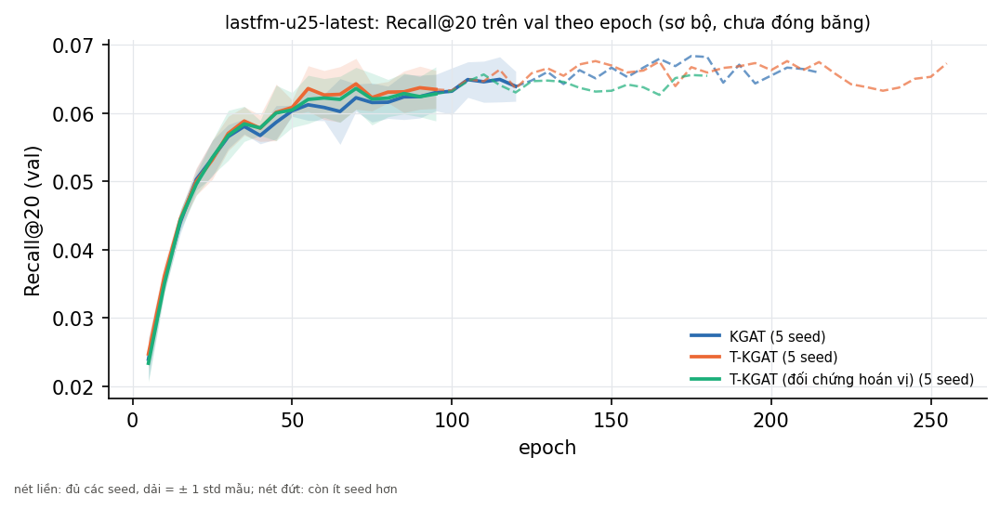

# Bảng RQ3 (tự sinh bởi `scripts/10_rq3_table.py`)

> **Số của KGAT, KGAT không KG, T-KGAT và T-KGAT hoán vị là kết quả sơ bộ, chưa đóng băng (tag `v0.2-kgat`), chạy trước khi cô duyệt giao thức** (t1/t2, quyết định 0002). Chưa có tag `v0.2-kgat`: các số này chưa đóng băng. KGAT và T-KGAT không tái lập từng bit trên GPU: coi chênh lệch giữa các lần chạy của một seed như nhiễu seed.

Nguồn: `results/registry.csv` qua `registry.load`, chỉ dòng `phase = test` không mang nhãn `-dirty`; mỗi mô hình lấy điểm của lần chạy mới nhất trên split mới nhất. Trung bình ± độ lệch chuẩn **mẫu** (`ddof=1`) qua các seed; một seed thì không có độ lệch chuẩn. Kiểm định: Wilcoxon cặp theo từng user (`tkgat.eval.stats`) trên trung bình các seed chung, Holm trong cùng bộ dữ liệu và metric, họ cố định gồm ba phép so sánh; hai phép của giai đoạn 2 (nếu có) là một họ riêng. KG gồm fact Wikidata (bản chụp 2026) và metadata MovieLens (quyết định 0011).

## lastfm-u25-latest (user test: 1341)

> Baseline chưa chạy ở lastfm-u25-latest: MostPop recent.

| Mô hình | Cấu hình | Recall@20 (test) | NDCG@20 (test) | Số seed |
|---|---|---|---|---|
| MostPop | window_days = None | 0,0296 | 0,0268 | 1 |
| MostPop recent | — | chưa chạy | chưa chạy | — |
| BPR-MF | dim = 64, l2 = 0.001, lr = 0.001 | 0,0609 ± 0,0051 | 0,0618 ± 0,0054 | 5 |
| KGAT [sơ bộ] | l2 = 0.0001, l2_kg = 1e-05, lr = 0.001, mess_dropout = 0.1 | 0,0673 ± 0,0029 | 0,0672 ± 0,0022 | 5 |
| KGAT không KG [sơ bộ] | l2 = 0.0001, l2_kg = 1e-05, lr = 0.001, mess_dropout = 0.1 | 0,0633 ± 0,0046 | 0,0658 ± 0,0044 | 5 |
| T-KGAT [sơ bộ] | gamma = 1, l2 = 0.0001, l2_kg = 1e-05, lr = 0.001, mess_dropout = 0.1 | 0,0676 ± 0,0037 | 0,0669 ± 0,0031 | 5 |
| T-KGAT (đối chứng hoán vị) [sơ bộ] | gamma = 1, l2 = 0.0001, l2_kg = 1e-05, lr = 0.001, mess_dropout = 0.1 | 0,0651 ± 0,0049 | 0,0645 ± 0,0034 | 5 |
| T-KGAT giai đoạn 2 (Δt trên KG) [sơ bộ] | gamma = 10, l2 = 0.0001, l2_kg = 1e-05, lr = 0.001, mess_dropout = 0.1, time_on = kg | 0,0661 ± 0,0018 | 0,0653 ± 0,0015 | 5 |
| T-KGAT giai đoạn 2 (đối chứng hoán vị ngày fact) [sơ bộ] | gamma = 10, l2 = 0.0001, l2_kg = 1e-05, lr = 0.001, mess_dropout = 0.1, time_on = kg | 0,0650 ± 0,0033 | 0,0645 ± 0,0017 | 5 |

**So sánh cặp** (hiệu = trước − sau):

| So sánh | Metric | Seed chung | n_pairs | n_nonzero | Hiệu trung bình | p thô | p Holm | Ghi chú |
|---|---|---|---|---|---|---|---|---|
| T-KGAT so với KGAT | Recall@20 | 5 | 1341 | 679 | 0,0003 | 0,733 | 0,733 | — |
| T-KGAT thật so với hoán vị | Recall@20 | 5 | 1341 | 643 | 0,0024 | 0,016 | 0,033 | — |
| KGAT so với KGAT không KG | Recall@20 | 5 | 1341 | 708 | 0,0040 | 0,0094 | 0,028 | — |
| T-KGAT giai đoạn 2 so với KGAT | Recall@20 | 5 | 1341 | 706 | -0,0011 | 0,135 | 0,270 | — |
| T-KGAT giai đoạn 2 thật so với hoán vị | Recall@20 | 5 | 1341 | 682 | 0,0011 | 0,843 | 0,843 | — |
| T-KGAT so với KGAT | NDCG@20 | 5 | 1341 | 850 | -0,0002 | 0,910 | 0,910 | — |
| T-KGAT thật so với hoán vị | NDCG@20 | 5 | 1341 | 834 | 0,0025 | 0,0015 | 0,0046 | — |
| KGAT so với KGAT không KG | NDCG@20 | 5 | 1341 | 841 | 0,0013 | 0,113 | 0,225 | — |
| T-KGAT giai đoạn 2 so với KGAT | NDCG@20 | 5 | 1341 | 853 | -0,0019 | 0,080 | 0,161 | — |
| T-KGAT giai đoạn 2 thật so với hoán vị | NDCG@20 | 5 | 1341 | 855 | 0,0008 | 0,554 | 0,554 | — |

