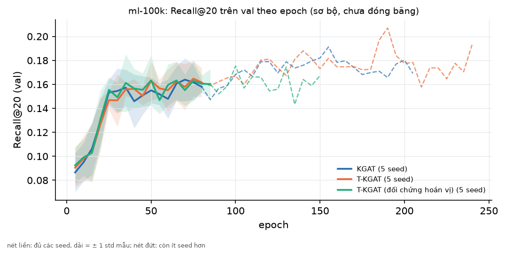
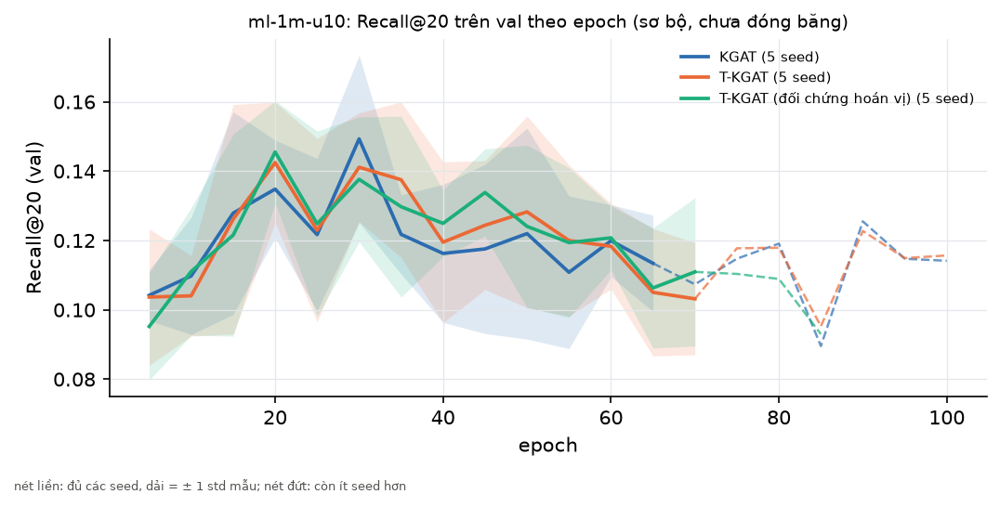

# Bảng RQ3 (tự sinh bởi `scripts/10_rq3_table.py`)

> **Số của KGAT, KGAT không KG, T-KGAT và T-KGAT hoán vị là kết quả sơ bộ, chưa đóng băng (tag `v0.2-kgat`), chạy trước khi cô duyệt giao thức** (t1/t2, quyết định 0002). Chưa có tag `v0.2-kgat`: các số này chưa đóng băng. KGAT và T-KGAT không tái lập từng bit trên GPU: coi chênh lệch giữa các lần chạy của một seed như nhiễu seed.
>
> **ml-1m-u10 là 10% user của ML-1M, không phải ML-1M đầy đủ.**

Nguồn: `results/registry.csv` qua `registry.load`, chỉ dòng `phase = test` không mang nhãn `-dirty`; mỗi mô hình lấy điểm của lần chạy mới nhất trên split mới nhất. Trung bình ± độ lệch chuẩn **mẫu** (`ddof=1`) qua các seed; một seed thì không có độ lệch chuẩn. Kiểm định: Wilcoxon cặp theo từng user (`tkgat.eval.stats`) trên trung bình các seed chung, Holm trong cùng bộ dữ liệu và metric, họ cố định gồm ba phép so sánh.

## ml-100k (user test: 51)

| Mô hình | Cấu hình | Recall@20 (test) | NDCG@20 (test) | Số seed |
|---|---|---|---|---|
| MostPop | window_days = None | 0,1555 | 0,1451 | 1 |
| MostPop recent | window_days = 14 | 0,3372 | 0,2870 | 1 |
| BPR-MF | dim = 32, l2 = 0.0001, lr = 0.001 | 0,1471 ± 0,0295 | 0,1549 ± 0,0170 | 5 |
| KGAT [sơ bộ] | l2 = 0.0001, l2_kg = 1e-05, lr = 0.001, mess_dropout = 0.1 | 0,2025 ± 0,0116 | 0,1753 ± 0,0107 | 5 |
| KGAT không KG [sơ bộ] | l2 = 0.0001, l2_kg = 1e-05, lr = 0.001, mess_dropout = 0.1 | 0,2017 ± 0,0232 | 0,1764 ± 0,0185 | 5 |
| T-KGAT [sơ bộ] | gamma = 1, l2 = 0.0001, l2_kg = 1e-05, lr = 0.001, mess_dropout = 0.1 | 0,2165 ± 0,0104 | 0,1843 ± 0,0076 | 5 |
| T-KGAT (đối chứng hoán vị) [sơ bộ] | gamma = 1, l2 = 0.0001, l2_kg = 1e-05, lr = 0.001, mess_dropout = 0.1 | 0,1989 ± 0,0176 | 0,1754 ± 0,0061 | 5 |

**So sánh cặp** (hiệu = trước − sau):

| So sánh | Metric | Seed chung | n_pairs | n_nonzero | Hiệu trung bình | p thô | p Holm | Ghi chú |
|---|---|---|---|---|---|---|---|---|
| T-KGAT so với KGAT | Recall@20 | 5 | 51 | 27 | 0,0140 | 0,163 | 0,333 | only 51 evaluation users (< 100); only 27 non-zero differences (< 30) |
| T-KGAT thật so với hoán vị | Recall@20 | 5 | 51 | 28 | 0,0176 | 0,111 | 0,333 | only 51 evaluation users (< 100); only 28 non-zero differences (< 30) |
| KGAT so với KGAT không KG | Recall@20 | 5 | 51 | 26 | 0,0008 | 0,919 | 0,919 | only 51 evaluation users (< 100); only 26 non-zero differences (< 30) |
| T-KGAT so với KGAT | NDCG@20 | 5 | 51 | 33 | 0,0090 | 0,098 | 0,295 | only 51 evaluation users (< 100) |
| T-KGAT thật so với hoán vị | NDCG@20 | 5 | 51 | 33 | 0,0089 | 0,249 | 0,498 | only 51 evaluation users (< 100) |
| KGAT so với KGAT không KG | NDCG@20 | 5 | 51 | 32 | -0,0011 | 0,681 | 0,681 | only 51 evaluation users (< 100) |

## ml-1m-u10 (user test: 95)

> ml-1m-u10 là 10% user của ML-1M, không phải ML-1M đầy đủ.

| Mô hình | Cấu hình | Recall@20 (test) | NDCG@20 (test) | Số seed |
|---|---|---|---|---|
| MostPop | window_days = None | 0,0846 | 0,1623 | 1 |
| MostPop recent | window_days = 3 | 0,1007 | 0,1619 | 1 |
| BPR-MF | dim = 32, l2 = 0.0001, lr = 0.001 | 0,1000 ± 0,0069 | 0,1889 ± 0,0102 | 5 |
| KGAT [sơ bộ] | l2 = 0.0001, l2_kg = 1e-05, lr = 0.001, mess_dropout = 0.1 | 0,1121 ± 0,0071 | 0,1989 ± 0,0071 | 5 |
| KGAT không KG [sơ bộ] | l2 = 0.0001, l2_kg = 1e-05, lr = 0.001, mess_dropout = 0.1 | 0,1042 ± 0,0101 | 0,1773 ± 0,0160 | 5 |
| T-KGAT [sơ bộ] | gamma = 1, l2 = 0.0001, l2_kg = 1e-05, lr = 0.001, mess_dropout = 0.1 | 0,1104 ± 0,0074 | 0,1964 ± 0,0041 | 5 |
| T-KGAT (đối chứng hoán vị) [sơ bộ] | gamma = 1, l2 = 0.0001, l2_kg = 1e-05, lr = 0.001, mess_dropout = 0.1 | 0,1107 ± 0,0078 | 0,1956 ± 0,0049 | 5 |

**So sánh cặp** (hiệu = trước − sau):

| So sánh | Metric | Seed chung | n_pairs | n_nonzero | Hiệu trung bình | p thô | p Holm | Ghi chú |
|---|---|---|---|---|---|---|---|---|
| T-KGAT so với KGAT | Recall@20 | 5 | 95 | 68 | -0,0017 | 0,623 | 1,000 | only 95 evaluation users (< 100) |
| T-KGAT thật so với hoán vị | Recall@20 | 5 | 95 | 63 | -0,0004 | 0,758 | 1,000 | only 95 evaluation users (< 100) |
| KGAT so với KGAT không KG | Recall@20 | 5 | 95 | 74 | 0,0079 | 0,0068 | 0,020 | only 95 evaluation users (< 100) |
| T-KGAT so với KGAT | NDCG@20 | 5 | 95 | 83 | -0,0025 | 0,928 | 0,928 | only 95 evaluation users (< 100) |
| T-KGAT thật so với hoán vị | NDCG@20 | 5 | 95 | 81 | 0,0009 | 0,317 | 0,634 | only 95 evaluation users (< 100) |
| KGAT so với KGAT không KG | NDCG@20 | 5 | 95 | 84 | 0,0217 | < 0,001 | < 0,001 | only 95 evaluation users (< 100) |

